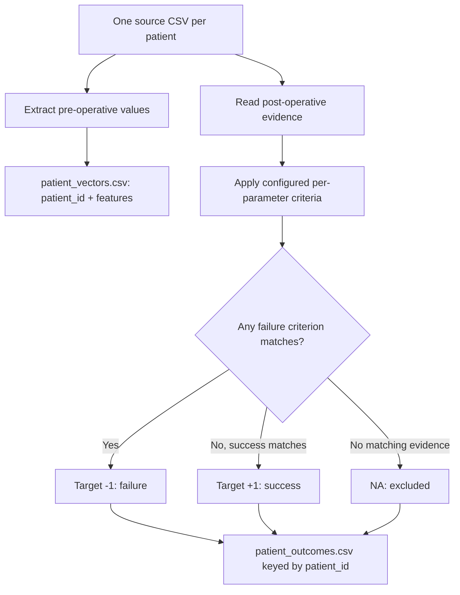
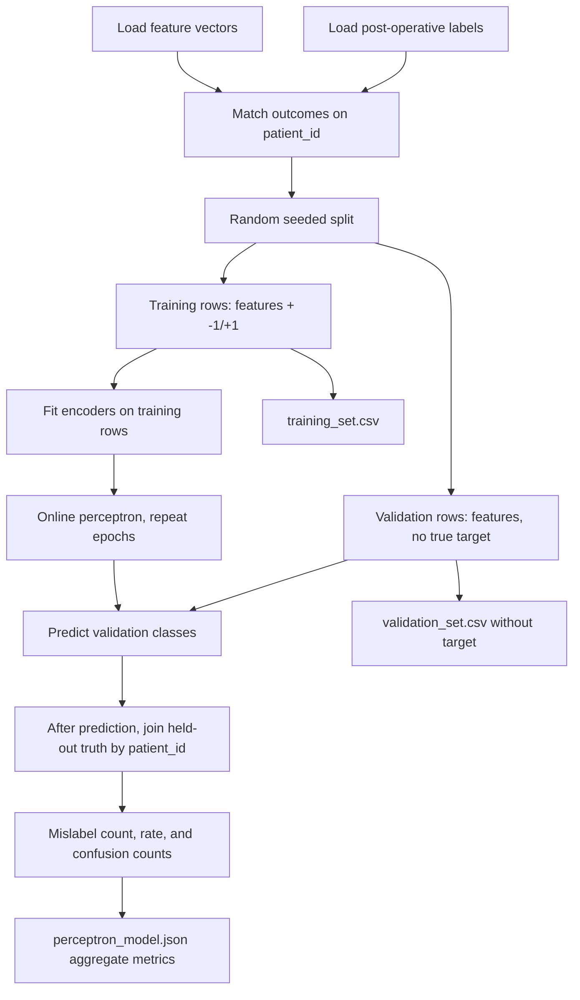

# Perceptron training and validation

Analysis produces two modeling files, joined by `patient_id`:

- `results/patient_vectors.csv`: pre-operative features only; no outcome label.
- `results/patient_outcomes.csv`: target and label evidence computed from post-operative observations.

A third CSV, `postoperative_measurements.csv`, keeps the aggregated post-operative values available for audit and plots. It is never a model input. This replaces the previous collection of duplicate CSV reports with three core extracts.



## Split, train, and evaluate

Run the analysis command first, then:

```powershell
py -3 -m src.cli analyze "C:\path\to\patient-csvs" --output "C:\path\to\results"
py -3 -m src.cli train-perceptron --input "C:\path\to\results\patient_vectors.csv" --outcomes "C:\path\to\results\patient_outcomes.csv" --training-set "C:\path\to\results\training_set.csv" --validation-set "C:\path\to\results\validation_set.csv" --model "C:\path\to\results\perceptron_model.json" --train-fraction 0.8 --epochs 100 --seed 42 --omit sex,asa
```

Training verifies that vector and outcome files have the same unique patient IDs, then joins by ID—not row order. The training set receives the post-operative target (`-1` failure, `+1` success). The validation set has no **true target**; the perceptron classifies its pre-operative features and writes a `prediction` column. Only after that prediction does evaluation look up postoperative truth for the same `patient_id` and calculate validation statistics. Rows with an `NA` outcome or missing selected input are excluded and counted.



The model uses the sequential Rosenblatt update. Weights begin at zero; for label `y` and encoded feature vector `x`, update when `y(w·x) ≤ 0` using `wᵢ ← wᵢ + yxᵢ/N`. Numeric scaling and categorical one-hot levels are fitted only on training rows. Training stops after a no-update epoch or the epoch limit.

## Output and statistics

The command writes `training_set.csv` (features plus the true `target`), `validation_set.csv` (features plus `prediction`; no true `target`), and `perceptron_model.json`. The JSON includes aggregate validation metrics, not patient rows or IDs:

- `misclassified`: validation cases where prediction differs from post-operative truth.
- `mislabeling_rate`: `misclassified / validation_size` (also the generalization error).
- `confusion`: counts for actual failure/success versus predicted failure/success.
- Training settings, encoding, weights, convergence, and excluded-row count.

Omitted feature IDs are read from the model's XML `trainingValidation/omit` list; the default `config/pipeline.xml` includes `operation_diagnosis_proxy` there. The CLI `--omit` option adds further comma-separated pre-operative parameter IDs. Use `--training-set`, `--validation-set`, and `--model` to change output paths. At least three eligible rows are required; the split must leave two training rows and one validation row, and training must contain both classes. Missing BMI is derived from weight and height when both are available, using the units configured in `config/pipeline.xml` (defaults kg/cm; supported weight units kg/g/lb and height units m/cm/in—verify source units before research use). Rows still missing another selected feature are excluded.

A single random holdout is a noisy estimate, especially for a small dataset. The perceptron is a hard linear classifier, not a calibrated probability estimator. Outcome criteria are project rules, not clinically validated endpoints; eight postoperative parameter thresholds remain pending clinical definition.
